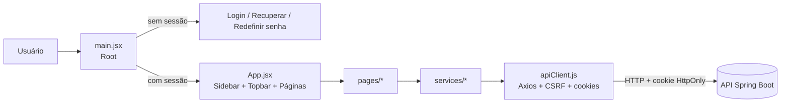

<div align="center">


# Sistema de Gerenciamento de Estoque — ONG AMAR

**Frontend web para controlar entradas, saídas, produtos, usuários e indicadores do estoque de doações de uma ONG.**


</div>

---

## Sumário

- [Sobre o projeto](#sobre-o-projeto)
- [Funcionalidades](#funcionalidades)
- [Acessibilidade e inclusão](#acessibilidade-e-inclusão)
- [Tecnologias](#tecnologias)
- [Arquitetura](#arquitetura)
- [Estrutura de pastas](#estrutura-de-pastas)
- [Como executar](#como-executar)
- [Variáveis de ambiente](#variáveis-de-ambiente)
- [Scripts disponíveis](#scripts-disponíveis)
- [Integração com o backend](#integração-com-o-backend)
- [Níveis de acesso](#níveis-de-acesso)
- [Autenticação e segurança](#autenticação-e-segurança)
- [Navegação](#navegação)
- [CI/CD e ambientes](#cicd-e-ambientes)
- [Padrões de código](#padrões-de-código)
- [Limitações conhecidas](#limitações-conhecidas)
- [Roadmap](#roadmap)
- [Como contribuir](#como-contribuir)

---

## Sobre o projeto

ONGs que trabalham com doações precisam saber, a qualquer momento, **o que entrou, o que saiu, o que está perto de vencer e o que está faltando**. Este projeto é o **frontend** de um sistema de gerenciamento de estoque pensado para esse cenário: voluntários registram movimentações do dia a dia e a coordenação acompanha indicadores e relatórios para planejar as próximas arrecadações.

O sistema conversa com uma **API REST em Spring Boot** (repositório separado) e foi construído com foco em **simplicidade de uso** e **acessibilidade**, já que quem opera o estoque nem sempre é técnico.

> Este repositório contém somente a interface. Para rodar de ponta a ponta, é necessário ter o backend em execução (por padrão em `http://localhost:8080`).

---

## Funcionalidades

| Módulo | O que faz |
| --- | --- |
| **Login** | Autenticação por e-mail e senha, com opção de alto contraste e ajuste do tamanho da fonte já na tela de entrada. |
| **Recuperar / Redefinir senha** | Solicita o link de recuperação por e-mail e redefine a senha por token (rota `/redefinir-senha`). |
| **Início** | Painel com atalhos para os serviços principais e **busca por serviço**. |
| **Gerenciar Entrada** | Registra entradas de produtos (quantidade, data de entrada e validade), mostra a **última entrada** e permite editar e excluir. |
| **Gerenciar Saída** | Registra saídas com marcação de **Perda**, mostra a **última saída** e permite editar e excluir. |
| **Cadastro de Produtos** | Cadastra produtos com categoria e unidade de medida, com edição e exclusão. *(somente administrador)* |
| **Cadastro de Usuário** | Cria usuários (Voluntário ou Administrador) com validação de senha forte e status ativo/inativo. *(somente administrador)* |
| **Históricos** | Listagens paginadas de entradas, saídas, produtos e usuários, com menu de ações por linha. |
| **Relatórios** | Gera relatórios em **PDF criados por IA** (entradas, saídas, desempenho e produtos cadastrados), com opção de cancelar a geração. *(somente administrador)* |
| **Desempenho (dashboard)** | KPIs de estoque atual, risco de vencimento, doações recebidas e itens distribuídos, mais gráficos mensais e estoque por tipo. *(somente administrador)* |
| **Configurações** | Métricas do dashboard *(somente administrador)*, alertas e notificações por e-mail e troca de senha. |
| **Chatbot** | Assistente Botpress embutido para tirar dúvidas de uso. |

### Destaques

- **Padrão "último registro + histórico":** as telas de cadastro mostram o último item lançado e levam ao histórico completo com paginação.
- **Dashboard sem biblioteca de gráficos:** os gráficos de barras e a lista de estoque por tipo são feitos com CSS, o que deixa o bundle enxuto.
- **Risco de vencimento:** o KPI usa a data da próxima doação como referência e abre um modal com os alimentos em risco; o período de risco configurado é compartilhado com os alertas por e-mail.
- **Níveis de acesso:** administrador acessa tudo; o voluntário só vê as telas operacionais. O menu, os atalhos da tela inicial e a navegação se ajustam ao perfil, e o backend reforça as regras com `403`.
- **Sessão sincronizada entre abas:** sair em uma aba encerra a sessão nas demais.
- **Validação de senha no cliente:** mínimo de 8 caracteres com maiúscula, minúscula, número e caractere especial (`@$!%*?&`).

---

## Acessibilidade e inclusão

Acessibilidade é parte central do produto:

- **VLibras:** widget do governo federal que traduz o conteúdo para Libras, disponível em todas as telas.
- **Controle de fonte (A+ / a-):** aumenta ou diminui o tamanho do texto na barra lateral e na tela de login.
- **Alto contraste:** alternância disponível na tela de login.
- **Semântica:** uso de `label` associado a cada campo, `aria-label` em botões só com ícone e `role="alert"` / `role="status"` nas mensagens de erro e sucesso.

---

## Tecnologias

| Camada | Tecnologia |
| --- | --- |
| Biblioteca de UI | [React 19](https://react.dev) |
| Build e dev server | [Vite 8](https://vite.dev) com `@vitejs/plugin-react` |
| HTTP | [Axios](https://axios-http.com) |
| Estilos | CSS Modules + variáveis CSS globais |
| Lint | [Oxlint](https://oxc.rs) (regras de hooks e `only-export-components`) |
| Fonte | Open Sans (Google Fonts) |
| Ícones | Icons8 (imagens) e SVGs inline |
| Acessibilidade | [VLibras](https://vlibras.gov.br) |
| Chatbot | [Botpress Webchat](https://botpress.com) |

Não há React Router nem biblioteca de estado global: a navegação e o estado são feitos com `useState` e props, o que mantém o projeto simples de entender.

---

## Arquitetura



**Fluxo em resumo**

1. `main.jsx` decide entre as telas públicas (login, recuperação, redefinição) e o app autenticado.
2. `App.jsx` monta o layout (barra lateral, barra superior e a página ativa) e controla a navegação.
3. As **páginas** cuidam da interface e do estado local; toda comunicação com o backend passa pelos **serviços**.
4. Os **serviços** usam o `apiClient`, que centraliza a URL base, cookies de sessão, token CSRF e o tratamento de erros.

---

## Estrutura de pastas

```text
projeto-ong-amar-frontend/
├── public/
├── src/
│   ├── assets/img/            # Logo da ONG
│   ├── components/
│   │   ├── common/            # Paginacao, Breadcrumb, InputPasswordToggle
│   │   ├── layout/            # Sidebar e Topbar
│   │   └── reports/           # PeriodFilter e ReportCard
│   ├── hooks/                 # useReports
│   ├── pages/                 # Telas (JSX + CSS Module por tela)
│   │   ├── Login, RecuperarSenha, RedefinirSenha
│   │   ├── Inicio, Desempenho, Relatorios, Configuracoes
│   │   ├── GerenciarEntrada, GerenciarSaida
│   │   ├── CadastroProdutos, CadastroUsuario
│   │   └── Historico (genérico) + HistoricoEntrada / Saida / Produtos / Usuario
│   ├── services/              # Camada de acesso à API
│   │   ├── apiClient.js       # Instância Axios central
│   │   ├── authService.js
│   │   ├── usuarioService.js
│   │   ├── produtoService.js
│   │   ├── entradaService.js / saidaService.js / movimentacaoService.js
│   │   ├── desempenhoService.js
│   │   ├── reportsService.js
│   │   └── configuracoesService.js
│   ├── styles/                # variables.css e global.css
│   ├── utils/                 # permissoes.js (níveis de acesso), formatDate.js, motivoSaida.js
│   ├── App.jsx                # Layout e roteamento por estado
│   └── main.jsx               # Ponto de entrada
├── .env.example
├── .github/workflows/     # CI e CD (ci.yml, cd.yml, deploy.yml)
├── .oxlintrc.json
├── deploy/                # docker-compose.yml usado no servidor
├── Dockerfile             # Build do Vite + Nginx
├── nginx.conf             # Fallback das rotas do SPA
├── index.html                 # VLibras e Botpress são carregados aqui
├── package.json
└── vite.config.js
```

---

## Como executar

### Pré-requisitos

- **Node.js** 20 ou superior (testado com Node 22)
- **npm** 10 ou superior
- **Backend** da ONG em execução (Spring Boot, porta `8080` por padrão)

### Passo a passo

```bash
# 1. Clone o repositório
git clone <url-do-repositorio>
cd projeto-ong-amar-frontend

# 2. Instale as dependências
npm install

# 3. Configure o ambiente
cp .env.example .env

# 4. Inicie o servidor de desenvolvimento
npm run dev
```

Abra o endereço exibido no terminal (normalmente `http://localhost:5173`).

### Build de produção

```bash
npm run build     # gera a pasta dist/
npm run preview   # serve o build localmente para conferência
```

---

## Variáveis de ambiente

| Variável | Descrição | Padrão |
| --- | --- | --- |
| `VITE_API_URL` | URL base da API do backend | `http://localhost:8080` |

O arquivo `.env` está no `.gitignore`. Versione apenas o `.env.example`.

---

## Scripts disponíveis

| Comando | Ação |
| --- | --- |
| `npm run dev` | Inicia o Vite em modo desenvolvimento com HMR |
| `npm run build` | Gera o build otimizado em `dist/` |
| `npm run preview` | Serve o build de produção localmente |
| `npm run lint` | Executa o Oxlint |

---

## Integração com o backend

Todos os endpoints são consumidos pela camada `src/services`.

### Autenticação e usuários

| Método | Rota | Uso |
| --- | --- | --- |
| `POST` | `/usuarios/login` | Login |
| `GET` | `/usuarios/me` | Valida a sessão e obtém o usuário logado |
| `POST` | `/usuarios/logout` | Encerra a sessão |
| `GET` / `PUT` | `/configuracoes/preferencias-notificacao` | Lê e salva as preferências individuais de e-mail |
| `GET` / `PUT` | `/configuracoes/metricas` | Lê e salva limites e períodos configuráveis do sistema |
| `POST` | `/usuarios/recuperacao-senha` | Solicita recuperação de senha |
| `POST` | `/usuarios/redefinir-senha` | Redefine a senha com token |
| `POST` | `/usuarios/cadastrar` | Cadastra usuário |
| `GET` | `/usuarios?tipoUsuario=` | Lista usuários (exige perfil ADMINISTRADOR) |
| `PUT` / `DELETE` | `/usuarios/{id}` | Atualiza / remove usuário |
| `GET` | `/csrf` | Inicializa o cookie `XSRF-TOKEN` |

### Produtos

| Método | Rota | Uso |
| --- | --- | --- |
| `GET` | `/produtos` | Lista produtos |
| `GET` | `/categoria` | Lista categorias |
| `POST` | `/produtos` | Cadastra produto |
| `PUT` / `DELETE` | `/produtos/{id}` | Atualiza / remove produto |

### Movimentações

| Método | Rota | Uso |
| --- | --- | --- |
| `GET` | `/movimentacao/entrada/historico?page=&size=` | Histórico paginado de entradas |
| `POST` | `/movimentacao/entrada` | Registra entrada |
| `PUT` / `DELETE` | `/movimentacao/entrada/{id}` | Atualiza / remove entrada |
| `GET` | `/movimentacao/saida/historico?page=&size=` | Histórico paginado de saídas |
| `POST` | `/movimentacao/saida` | Registra saída |
| `PUT` / `DELETE` | `/movimentacao/saida/{id}` | Atualiza / remove saída |

### Dashboard

| Método | Rota | Uso |
| --- | --- | --- |
| `GET` | `/dashboard/kpi-estoque-atual` | KPI de estoque atual |
| `GET` | `/dashboard/kpi-risco-vencimento` | KPI de risco de vencimento |
| `GET` | `/dashboard/modal-kpi-risco-vencimento` | Lista de alimentos em risco |
| `GET` | `/dashboard/kpi-doacoes-recebidas` | KPI de doações recebidas |
| `GET` | `/dashboard/kpi-itens-distribuidos` | KPI de itens distribuídos |
| `GET` | `/dashboard/movimentacoes-por-mes` | Gráfico de recebidos x entregues |
| `GET` | `/dashboard/estoque-por-tipo` | Estoque por tipo |
| `GET` | `/dashboard/estoque-fechamento-por-mes` | Estoque de fechamento mensal |

Os KPIs recebem o parâmetro `dataProximaDoacao` e consideram os 30 dias anteriores a essa data.

### Relatórios com IA

| Método | Rota | Arquivo gerado |
| --- | --- | --- |
| `POST` | `/assistente/relatorio/entradas/pdf` | `relatorio-entradas.pdf` |
| `POST` | `/assistente/relatorio/saidas/pdf` | `relatorio-saidas.pdf` |
| `POST` | `/assistente/relatorio/desempenho-geral/pdf` | `relatorio-desempenho.pdf` |
| `POST` | `/assistente/relatorio/produtos-cadastrados/pdf` | `relatorio-produtos-cadastrados.pdf` |

O front envia uma `pergunta` em texto e recebe o PDF como `blob` para download.

---

## Níveis de acesso

O sistema tem dois perfis, definidos no cadastro do usuário e devolvidos pelo backend em `POST /usuarios/login` e `GET /usuarios/me` (campo `tipoUsuario`).

| Funcionalidade | Administrador | Voluntário |
| --- | :---: | :---: |
| Início | ✅ | ✅ |
| Gerenciar Entrada e Saída (e históricos) | ✅ | ✅ |
| Configurações: alertas, notificações e senha | ✅ | ✅ |
| Cadastro de Produtos (e histórico) | ✅ | ❌ |
| Relatórios | ✅ | ❌ |
| Desempenho, Estoque Atual e Risco de Vencimento | ✅ | ❌ |
| Configurações: métricas do dashboard | ✅ | ❌ |
| Cadastro de Usuário (e histórico) | ✅ | ❌ |

**Como funciona no frontend**

- As regras ficam centralizadas em `src/utils/permissoes.js` (`podeAcessarPagina`, `podeConfigurarMetricas`).
- `Sidebar` e `Inicio` escondem o que o perfil não pode acessar; `App.jsx` bloqueia a navegação direta e exibe "Você não tem permissão para acessar a página…".
- Em `Configuracoes`, o voluntário não vê a aba "Métricas de Estoque" e abre direto em "Notificações e Alertas".

> **Importante:** esconder telas é apenas conforto de uso. A proteção real está no backend, que responde `403` para qualquer chamada fora do perfil (relatórios, dashboard, cadastro de produtos e de usuários, salvar métricas).

---

## Autenticação e segurança

- **Sessão por cookie HttpOnly:** o token de sessão (`authToken`) fica em cookie e não é acessível por JavaScript. O Axios usa `withCredentials: true`.
- **Proteção CSRF:** após o login, o app chama `GET /csrf`. O Axios lê o cookie `XSRF-TOKEN` e envia o header `X-XSRF-TOKEN` em toda requisição mutável (POST, PUT, PATCH, DELETE).
- **Logout automático:** qualquer resposta `401` limpa os dados locais e dispara o evento `sessao-encerrada`, devolvendo o usuário ao login.
- **Sincronização entre abas:** o evento `storage` encerra a sessão em todas as abas ao sair de uma.
- **Dados locais mínimos:** apenas `id`, `nome`, `email` e `tipoUsuario` ficam no `localStorage`, para exibição e para ajustar o menu ao perfil.
- **Perfis:** o backend distingue `ADMINISTRADOR` e `VOLUNTARIO` e valida o perfil a cada requisição. Veja [Níveis de acesso](#níveis-de-acesso).

> **Importante:** nunca versione o arquivo `.env` com valores reais. O `.gitignore` já o ignora.

---

## Navegação

A aplicação não usa React Router. A página ativa é um estado em `App.jsx` (`activePage`), mapeado em um dicionário `PAGES`.

| Chave | Tela |
| --- | --- |
| `inicio` | Início |
| `gerenciar-entrada` / `historico-entrada` | Entrada e seu histórico |
| `gerenciar-saida` / `historico-saida` | Saída e seu histórico |
| `cadastro-produtos` / `historico-produtos` | Produtos e seu histórico |
| `cadastro-usuario` / `historico-usuario` | Usuários e seu histórico |
| `relatorios` | Relatórios |
| `desempenho` | Dashboard |
| `configuracoes` | Configurações |
| `recuperar-senha` / `redefinir-senha` | Recuperação de senha |

Nas telas de histórico, o botão **Voltar** retorna à tela de origem e o item correspondente do menu lateral continua destacado.

### Adicionando uma nova página

1. Crie `src/pages/MinhaPagina.jsx` (e o `.module.css` correspondente).
2. Registre em `PAGES` e em `SECTION_LABELS`, dentro de `src/App.jsx`.
3. Se deve aparecer no menu, adicione um item em `NAV_ITEMS`, em `Sidebar.jsx`.
4. Se a tela for restrita ao administrador, inclua a chave em `PAGINAS_SOMENTE_ADMIN`, em `src/utils/permissoes.js`. Menu, atalhos e navegação passam a respeitar a regra automaticamente.

### Histórico genérico

`pages/Historico.jsx` é um componente reutilizável. Cada histórico apenas informa título, colunas e uma função `carregarPagina(pagina, tamanho)`:

```jsx
<Historico
  titulo="Histórico de Usuários"
  entidadeNome="usuário"
  carregarPagina={carregarPagina}
  aoEditar={abrirEdicao}      // opcional: habilita a ação de editar
  aoExcluir={excluir}         // opcional: habilita a ação de excluir
  colunas={[{ chave: 'nome', rotulo: 'Nome', render: (item) => item.nome }]}
/>
```

---

## CI/CD e ambientes

O fluxo de branches e ambientes é:

```text
feature/* ──PR──> develop ──PR──> main
                     │              │
                     ▼              ▼
              desenvolvimento   homologação ──(aprovação)──> produção
```

| Evento | O que acontece |
| --- | --- |
| PR para `develop` ou `main` | CI: `npm ci`, `npm run lint` e `npm run build`. PRs para `main` só aceitam origem `develop` ou `hotfix/*` |
| Merge em `develop` | CI e deploy automático em **desenvolvimento** |
| Merge em `main` | CI, deploy em **homologação** e, após aprovação manual, em **produção** |
| *Run workflow* manual | Promove ou faz rollback de qualquer branch, tag ou SHA para o ambiente escolhido |

- Os workflows estão em `.github/workflows/` (`ci.yml`, `cd.yml` e o reutilizável `deploy.yml`).
- A imagem Docker (Node para o build + Nginx) usa `VITE_API_URL=/api`: o Nginx serve o SPA e faz proxy de `/api/*` para o backend **no mesmo domínio**, necessário porque o cookie de sessão é `SameSite=Strict`. É a mesma arquitetura do `pca-setup`.
- Configuração de Environments, secrets e servidor: [docs/CICD.md](docs/CICD.md).

O `nginx.conf` da raiz também é o arquivo que o `frontend.Dockerfile` do `pca-setup` espera encontrar no repositório. Para subir tudo junto (MySQL + backend + frontend), use o `pca-setup hosting` ou o `deploy/docker-compose.yml`.

Para apenas construir a imagem:

```bash
docker build -t amar-frontend .
```

---

## Padrões de código

- **Nomes em português** para variáveis, funções e classes CSS de domínio (`cadastrarUsuario`, `envoltorioTabela`).
- **Um CSS Module por página**, com variáveis de tema em `src/styles/variables.css`.
- **Serviços finos:** cada função de serviço mapeia uma rota e não contém regra de tela.
- **Erros padronizados:** o `apiClient` converte respostas de erro em `Error` com a mensagem vinda do backend (`mensagem`, `message` ou `error`).
- **Lint:** rode `npm run lint` antes de abrir um pull request.

### Tema

As cores e espaçamentos ficam em variáveis CSS (`--blue`, `--yellow`, `--radius`, `--space-*`), o que facilita ajustar a identidade visual em um só lugar.

---

## Limitações conhecidas

Pontos que dependem de evolução no backend ou de acabamento no front:

- **Listagem de usuários sem `id`:** `GET /usuarios` não retorna o `id`, então editar e excluir a partir do histórico de usuários ainda não é possível. As funções `atualizarUsuario` e `removerUsuario` já estão prontas em `usuarioService.js`.
- **"Perda" na saída:** o backend não tem um campo próprio para isso. A marcação é guardada como prefixo no texto do motivo (`Perda: ...`), conforme `utils/motivoSaida.js`. O motivo é escolhido em uma **lista fixa** (definida nesse arquivo) com a opção **"Outros"** para texto livre; ao selecionar "Produto vencido" ou "Produto danificado", a chave **Perda** é ativada automaticamente (e pode ser alterada manualmente).
- **Filtro de período em Relatórios:** o componente `PeriodFilter` existe, mas o período ainda não altera os relatórios gerados.
- **Notificações por e-mail:** as preferências individuais são persistidas no backend. O SMTP Gmail para alertas é configurado exclusivamente no servidor; o envio ocorre em segundo plano após o backend confirmar a movimentação, e a senha de app nunca deve ser incluída no frontend.

Consulte o [guia de configuração e uso do SMTP Gmail](https://github.com/projeto-ong-amar/projeto-ong-amar-backend/blob/main/docs/README_NOTIFICACOES_GMAIL.md), mantido no repositório do backend.
- **Troca de senha do voluntário:** a troca de senha usa `PUT /usuarios/{id}`, que exige perfil administrador, então o voluntário recebe `403`. A correção prevista é um endpoint próprio (`PUT /usuarios/me/senha`).
- **Sem roteamento por URL:** por não usar React Router, não é possível favoritar ou compartilhar o link de uma tela específica (exceto `/redefinir-senha`).
- **Sem testes automatizados** no momento.
- **Ícones remotos:** os ícones vêm do Icons8 e exigem internet.

---

## Roadmap

- [ ] Expor o `id` na listagem de usuários e habilitar editar/excluir no histórico
- [ ] Migrar a navegação para React Router
- [ ] Aplicar o filtro de período aos relatórios
- [x] Persistir preferências individuais de notificação no backend
- [ ] Testes unitários e de integração (Vitest + Testing Library)
- [ ] Trocar ícones remotos por SVGs locais
- [x] Pipeline de CI com lint e build
- [x] Entrega contínua com ambientes de desenvolvimento, homologação e produção
- [x] Níveis de acesso (administrador e voluntário)
- [ ] Endpoint para o próprio usuário trocar a senha

---

## Como contribuir

1. Atualize a `develop` e crie sua branch a partir dela: `git checkout -b feat/minha-funcionalidade`.
2. Faça commits pequenos e descritivos, por exemplo `feat: adiciona filtro por período`.
3. Rode `npm run lint` e `npm run build`.
4. Abra um Pull Request **para a `develop`** descrevendo o que mudou e como testar. O CI precisa passar.
5. A promoção para homologação e produção é feita por PR de `develop` para `main`.

---

<div align="center">

Feito com dedicação para apoiar o trabalho da **ONG AMAR** 💙

</div>
